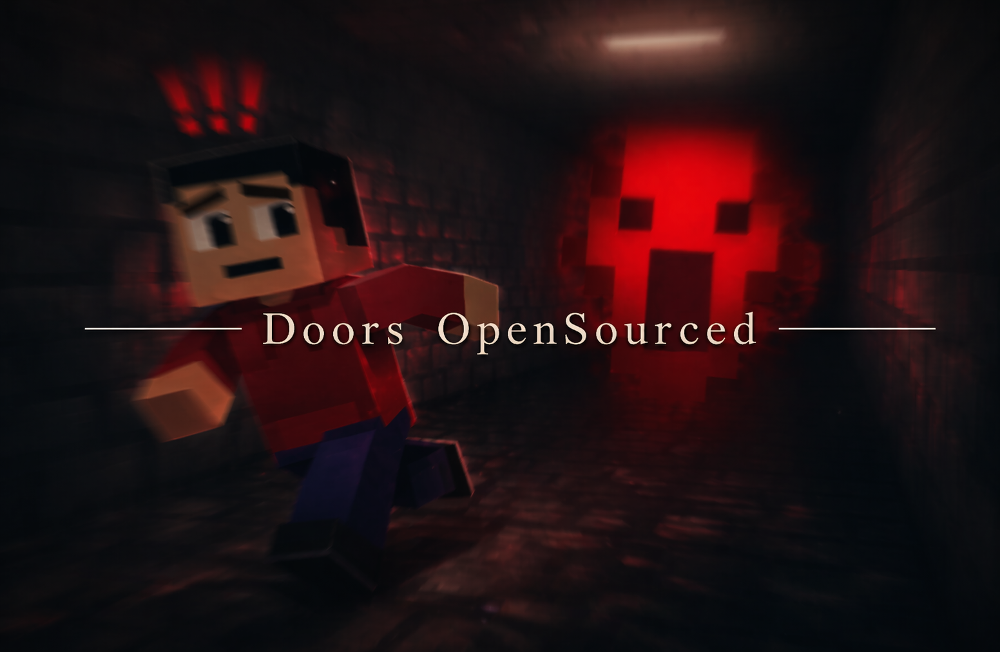

# doors open sourced

make sure to join https://bloxdhub.com

this doc is the breakdown for how the game works.

this is p much me dumping the real logic and the weird tricks we used so if ur reading the code and wondering why some part feels fake or oddly timed, there is prob a reason for it.

credit for the ticktimer goes to `@_frostycaveman` on discord.

## what this doc is about

this doc is mostly about the stuff players run into in the prod game. or at least the main parts.

the main things in here are:

- how `world code.js` runs the whole thing
- how the lift area decides when a run can start
- how the elevator ride is faked
- how rooms are generated and connected
- how we warm chunks up before building
- how dark rooms work
- how progressive darkness works
- how closets work
- how the main entities work
- how combos work
- how the game buys itself time and hides the ugly parts

u will still see some old refs and other leftovers in the codebase tho. some of that is older hotel stuff, some of it is things that never fully made it in, and some of it is for later stuff. that is just how the project ended up over time. note, i have pushed everything related to the current public state of the game (i.e the rooms) but most of the hotel files havent been pushed out yet since thats a WIP section.

## how the world code runs the game

`world code.js` is p much the main component (but without the codeblocks, its rendered useless)

most of the files are just helpers, room builders, or systems waiting to get called from there.

the main big jobs it handles are:

1. loading the stored codeblocks from the world
2. running the ticktimer
3. processing queued api work
4. rebuilding player snapshots
5. updating systems every tick or every few ticks
6. catching join, leave, respawn, chat, chest, and alt action events

the reason this matters is because the game isnt really a bunch of files acting on their own, its more like one main runtime loop with a lot of attached pieces.

that custom ticktimer matters a lot too - without it, timing gets messy fast when u have:

- ride timing
- room chain timing
- warning delays
- cleanup
- death screens
- particle loops
- entity waits

so instead of sprinkling random timers all over and hoping they line up, most of the game timing sits on the world tick.

the other useful part in `world code.js` is `apiQueue`.

that one doesnt seem very important at all, but it helps a lot

if several systems decide to hit the api at the same time, the queue helps spread that out instead of letting everything slam at once.

the player snapshot part matters too.

the runtime rebuilds player info once per tick, and later systems read from that instead of each system going out and spamming fresh reads for the same player every second.

that saves calls and also keeps behavior more consistent during the tick.

## how a run actually starts

the run does not start just because somebody walks near the elevator.

there is a real bounding box check in [System 22 - Lobby Start Zone.js](./Doors/Systems/System%2022%20-%20Lobby%20Start%20Zone.js)

that file has:

- `LSZ_MIN`
- `LSZ_MAX`

those are p much the two corners for the lift area box.

the system checks who is inside that area.

if not everybody is inside, nothing starts.

if everybody is inside, it begins the countdown.

after the countdown finishes, it locks the roster and starts `startBuiltRoomsRide()`.

that was useful because it stopped the game from starting while one player was still outside or lagging behind in the lobby.

## how the elevator really works

the elevator is fake but in a weird way... its everyones fav part :sob:

its not some giant moving box going down through the map (would cost too much and im not even sure if its possible)

the main trick is p much just the particles and the sounds to sell the realism
but the particles stream under the lift is the best part. its p much the whole trick.

that logic is in `startElevator()` inside [0 Elevator.js](./Doors/Room%20gen/0%20Elevator.js).

what it does is keep the room fixed, then spam particle bursts from under the platform in a way that makes it feel like the lift is moving through air.

the helper inside there is `spawnParticles(speed, texture, size)`, which is doing most of the heavy lifting here.

it fires three particle effects per burst:

- one strip on the left side
- one strip on the right side
- one strip near the front span

so instead of particles coming from one ugly point, the effect wraps around the bottom edges more and feels wider.

the particles always shoot upward with:

- `dir1: [0, 1, 0]`
- `dir2: [0, 1, 0]`

the gravity is also pushed upward with:

- `gravity: [0, speed * 10, 0]`

so the faster the current ride phase is, the harder the particles get pushed. sooo lol the code isnt moving the elevator down.

its pushing particles up hard enough that ur brain reads it as the elevator dropping

also, another thing to note is that when the speed is low, the lifetime is longer:

- `minLifeTime = 4`
- `maxLifeTime = 5`

when the speed is high, the lifetime gets much shorter:

- `minLifeTime = 0.8`
- `maxLifeTime = 1.2`

that helps a lot bcuz slow particles hanging around longer means theyre less likely to despawn (we dont want them to randomly pop out infront of the player)

emit power also scales with the phase:

- `minEmitPower = speed`
- `maxEmitPower = speed * 1.5`

the size changes as well. the code swaps between smaller square particles and larger drift particles depending on the phase, so the ride does not look flat the whole way through.

the ride timing is split into a few diff phases:

1. fast buildup
2. heavy middle section
3. slowdown
4. tiny calm phase
5. landing and cleanup

more exactly:

- early on it ramps up from basically nothing to around `40` speed with `square_particle`
- then it pushes much harder up to around `120` speed with `drift`
- then it slows back down
- then it almost chills out with a tiny `0.5` speed phase before cleanup

there are also sound beats at a few specific times so the ride keeps feeling alive and not like a silent particle loop, which helps more than u would think.

the other important part is why the ride is even there for that long (and why cant we just skip it??)

its not just there because it looked cool (even tho it DOES look cool. bloxdhub.com :). it was there because the game needed breathing room.

while the player is stuck inside the fake ride, the game can:

- place people into the fixed lift shell
- finish setup around the run start
- build the spawn room
- kick off the room chain
- let chunk warmup happen
- hide the seams before the player can start looking for them

so yea, the elevator is also p much a cover for setup time.

if we opened the door too early, players would catch the game still getting itself together. keeping them in the lift for that bit gives the room chain time to start without looking busted.

## how room generation works

the room generation flow is more like a handoff chain than one big function.

the rough path is:

1. elevator flow begins
2. spawn room gets built first
3. generator stores the first exit
4. generator picks a new room type
5. case logic figures out where that room should go
6. room builder places it
7. generator stores the new exit
8. repeat until the end room

the main state for that lives in `RS` inside [7 Room Generator.js](./Doors/Room%20gen/7%20Room%20Generator.js).

that object keeps stuff like:

- current exit position
- current exit side
- room number
- target room count
- room cooldowns
- buffer state
- throttle flags
- end room state

that is why the next room can always attach correctly. the generator is always carrying the last valid exit forward.

## how rooms connect to each other

this part is simpler than it looks when u first read the code.

every room mostly just needs to answer:

- where is the entrance?
- where is the exit?
- what side is the exit facing?
- why the heck do you not have a bloxdhub.com account yet? (ok not this part. but valid concern.)

the previous room exit becomes the new room entrance.

after the current room is built, the generator saves the new exit back into `RS` and so the chain just keeps passing the exit forward.

the annoying part is the offsets.

every room type has different size, shape, and turn behavior, so [16 Room Generator Cases.js](./Doors/Room%20gen/16%20Room%20Generator%20Cases.js) and [19 New Room Cases.js](./Doors/Room%20gen/19%20New%20Room%20Cases.js) end up doing a lot of alignment math, which is annoying but v important.

that is why those files can look repetitive. but they are mostly dealing with:

- if the player enters from this side, put the room here (the hotels reference since the rooms goes in one direction)
- if it rotates, shift the exit like this
- if it mirrors, center it like that
- if its a different shape, move the door offset over

it isnt exciting code, but its the part that stops rooms from clipping into each other or leaving bad gaps.

## how we preload chunks before building

this part is very important for a game like doors. if the chunk doesnt load, a good amount of blocks in the room will go missing (Even the floor or walls) as u progress.

in the live path we use here, the preload trick is mostly the `api.getBlock(...)` sweep in [7 Room Generator.js](./Doors/Room%20gen/7%20Room%20Generator.js).

before a room gets built, `generateNextRoom()` pokes the area around the next entrance.

the radius is usually:

- `64` for hallway
- `32` for most other rooms

so the flow is p much:

1. pick the next room
2. figure out where its entrance is going to be
3. `getBlock` around that area
4. wait a bit
5. start placing the room

that `getBlock` sweep is the warmup. it wakes the nearby area up before the builder starts writing there.

the old sample files did have more explicit preload code with `getChunk(...)` and `isBlockInLoadedChunk(...)`, but the acc path we use here is the lighter `getBlock` one. (as of writing this message, i have not pushed the sample files out and i dont plan on doing so anytime soon):

## how the room builders avoid turning into a mess

the room builders are staged on purpose.they do not just try to dump the entire room in one hit.

most of them go through phases like:

- floor
- shell
- roof
- trim
- decor
- doors
- room number
- finish

the boring but important performance rule is:

- use `setBlockRect` for big flat areas
- use `setBlock` for one off stuff (tho ik, some of my code which could use setblockrect is still using setblock.)

if u tried doing whole floors and walls with giant `setBlock` loops, it would get rough way faster. (since setblock is considered 1 api call.. and a wall would have a ton of blocks.)

the generator also waits for room builders to finish before chaining too hard into the next step. thats why some state checks keep showing up around build completion.

esp with stblockrect, its sometimes faster.

## room bounds and why other systems care about them

rooms are not only placed visually.

they also get registered.

the important things stored are:

- room bounds
- room doors
- dark room flags

that matters because later systems need to know:

- what room a player is standing in
- whether that room is marked dark
- whether a door should trigger a dark room preset
- what rooms entities can react to

without that info, the rest of the game would have to guess too much.

## dark room manager vs progressive darkness

these are two different systems doing two different jobs.

dont mix them up...

### dark room manager

[System 5 - Dark Room Manager.js](./Doors/Systems/System%205%20-%20Dark%20Room%20Manager.js) is the room based darkness system.

it decides whether a specific room becomes one of the dark rooms.

it keeps track of:

- room bounds
- door mapping
- dark flags
- streak and cooldown state

it isnt just pure random forever either.

there is a streak idea in there so the game can:

- keep early rooms safe
- slowly raise the chance
- allow short runs of dark rooms sometimes
- then cool back off

that makes the darkness feel more intentional and less like the game is flipping coins badly. its called scaling chance. stay in school guys (School never taught me that tho)

when a tracked door opens into a dark room, the system can throw on the darker preset right there.

that preset is p much:

- darker sky
- tighter fog
- way less visibility

worth noting, this dark system is only used by the hotel (not the rooms)

### progressive darkness

[System 15 - Progressive Darkness.js](./Doors/Systems/System%2015%20-%20Progressive%20Darkness.js) is different.

this one isnt about one specific room being dark.

its about the whole run getting heavier the deeper u go. it uses room progression to push visuals further over time, such as:

- stronger tint
- rougher fog
- darker feel overall

so the split is p much:

- dark room manager = this room is a dark room
- progressive darkness = the run itself is getting more oppressive

both are visuals, but they are not the same feature.

just like the sponsor of todays uhh document. bloxdhub.com (i need to stop with these promos man)

## how closets actually work

the closet system is in [System 1 - Closet Interaction.js](./Doors/Systems/System%201%20-%20Closet%20Interaction.js).

this isnt just a yes or no flag (if you played the game, ud already know that)

instead, the player gets moved into the closet position and locked there.

the basic flow is:

1. player clicks the closet door block
2. system checks if that block is one of the tracked closet doors
3. system checks if the closet is already occupied
4. system checks cooldown
5. system works out the inside position from the door rotation
6. player gets moved inside
7. movement gets locked
8. closet tint gets applied
9. signs you up for bloxdhub.com

the system tracks a bunch of state for this:

- occupied closets
- player to closet mapping
- cooldowns
- pending actions
- tint restore data

the pending action part is important because without it, weird click timing can fire and cause rate limits.

on exit it:

- moves the player back out
- restores the old tint
- clears occupancy
- re-applies progressive darkness for the room they are back in

that last bit matters more than it looks since without it, players could come out of a closet still carrying the wrong visual state.

## how auto doors fit in

[System 4 - Auto Door Opener.js](./Doors/Systems/System%204%20-%20Auto%20Door%20Opener.js) is mostly glue.

the room builders register doors into it, and later the system helps handle the open behavior when players get near or when the room flow wants those doors tracked cleanly.

it isnt the best system, but a lot of the room chain would feel way less smooth without it.

(this is also a feature which never made it into the real doors game. it was supposed to auto open the doors when you get close to them but i decided to scrap that idea last minute.)

## how the entities are really done

the main thing to get is that a lot of the scary feeling is presentation and timing, not some insanely complicated ai

the entity systems mostly care about:

- what rooms are valid
- where the path points are
- when the warning should happen
- when to kill check
- when to stop
- how to not overlap too badly with other entity logic

the visuals are usually particles, sounds, screen effects, and timed checks.

that is why they can feel heavier than they really are under the hood.

## a15

[System 23 - A15 Entity.js](./Doors/Systems/System%2023%20-%20A15%20Entity.js) is one of the earlier chase style entities (kinda the tutorial guide lol)

the system builds a path through tracked rooms, does the warning timing, then runs the pass and checks who gets hit.

its a more straightforward version of the same general idea used by the later entities.

## a60

[System 16 - A60 Entity.js](./Doors/Systems/System%2016%20-%20A60%20Entity.js) stores room path info in `A60_ROOMS`.

that gives it the route to move through the current run.

the visual body is mostly particles and effects placed along that path.

so again, its not some giant real creature model pathing through the map.

its more of:

1. keep track of valid rooms
2. build waypoint style positions
3. play the warning
4. run the pass
5. kill check players who failed the hide condition

it also has combo planning hooks with `A90`, which will matter in a few secs.

## a90

[System 18 - A90 Entity.js](./Doors/Systems/System%2018%20-%20A90%20Entity.js) is the stop and freeze style entity.

this one is less about room travel and more about interrupting the player at the right time.

it can run standalone or get chained into other entity events (more likely)

that is why combos feel scary. it does not always need to own the full scene by itself.

it can just show up at the worst moment. (ps: i love you a90)

## a120

[System 19 - A120 Entity.js](./Doors/Systems/System%2019%20-%20A120%20Entity.js) is more involved.

it handles:

- warning stage
- pathing through the run
- reverse passes
- kill checks
- timing around combos

so its not just one forward sweep and done.

that back and forth behavior is a big part of why it feels rough on the player.

## how combos work

combo logic is mostly about timing and ownership.

the systems need to know when one entity can show up without completely breaking what another one is alr doing.

thats why there are checks for active states, combo flags, cooldown style waits, and scheduled warning windows, otherwise it would get messy v quick.

the game is basically trying to let entities stack in a scary way without wrecking the game or making it unfair..

`A90` is a big part of that because it can interrupt another entity event instead of needing to be the whole event on its own. (tho it slows that entity down if both combo)

## guiding light

[System 17 - Guiding Light.js](./Doors/Systems/System%2017%20-%20Guiding Light.js) handles the death and win guidance stuff.

the useful part here is that its not one static message.

some of the message sets depend on what killed the player and how many times they have already seen that outcome, which made it feel way better in practice.

so p much, the system slowly gives more context instead of dumping every explanation all at once. that made the death feedback feel more like part of the game instead of just a flat fail screen.

## how the game hides seams on purpose

a lot of the game feel is just hiding the ugly parts well enough.

the lift is a good example.

its a fixed shell with particles pretending it is moving... it sounds silly if u say it too directly, but it works because:

- players are locked in the scene
- theres sound support
- the particle flow is strong enough to sell motion
- the run start logic is happening while they are distracted

same idea shows up in other places as well

- darkness hides detail.
- entity visuals lean on particles and timing.
- closets snap players into a controlled state.
- doors and bounds help other systems act like they understand the map more cleanly than they really do on first glance.

so uhh, a lot of the game is real, but a lot of the feeling comes from smart fakeouts and controlled timing.

## what is intentionally not treated as the current live flow

some parts of the bigger doors folder were not brought into this open sourced mirror because they are not part of the current live path.

that includes:

- old room ideas
- earlier hotel chapter leftovers
- branches that never became the main system
- testing only files

if you see references to files that are not in this folder, that usually means the file is legacy, unreleased, or was only used during testing.

## if u are trying to read the code in a good order

this is prob the nicest order lol:

1. [Doors/World Code.js](./Doors/World%20Code.js)
2. [Doors/Systems/System 22 - Lobby Start Zone.js](./Doors/Systems/System%2022%20-%20Lobby%20Start%20Zone.js)
3. [Doors/Room gen/0 Elevator.js](./Doors/Room%20gen/0%20Elevator.js)
4. [Doors/Room gen/7 Room Generator.js](./Doors/Room%20gen/7%20Room%20Generator.js)
5. [Doors/Room gen/16 Room Generator Cases.js](./Doors/Room%20gen/16%20Room%20Generator%20Cases.js)
6. [Doors/Room gen/19 New Room Cases.js](./Doors/Room%20gen/19%20New%20Room%20Cases.js)
7. [Doors/Systems/System 5 - Dark Room Manager.js](./Doors/Systems/System%205%20-%20Dark%20Room%20Manager.js)
8. [Doors/Systems/System 15 - Progressive Darkness.js](./Doors/Systems/System%2015%20-%20Progressive%20Darkness.js)
9. [Doors/Systems/System 1 - Closet Interaction.js](./Doors/Systems/System%201%20-%20Closet%20Interaction.js)
10. [Doors/Systems/System 16 - A60 Entity.js](./Doors/Systems/System%2016%20-%20A60%20Entity.js)
11. [Doors/Systems/System 18 - A90 Entity.js](./Doors/Systems/System%2018%20-%20A90%20Entity.js)
12. [Doors/Systems/System 19 - A120 Entity.js](./Doors/Systems/System%2019%20-%20A120%20Entity.js)
13. [Doors/Systems/System 17 - Guiding Light.js](./Doors/Systems/System%2017%20-%20Guiding%20Light.js)

## the short file map

if u jus want the important files first

- [Doors/World Code.js](./Doors/World%20Code.js)
- [Doors/Room gen/0 Elevator.js](./Doors/Room%20gen/0%20Elevator.js)
- [Doors/Room gen/7 Room Generator.js](./Doors/Room%20gen/7%20Room%20Generator.js)
- [Doors/Room gen/16 Room Generator Cases.js](./Doors/Room%20gen/16%20Room%20Generator%20Cases.js)
- [Doors/Room gen/19 New Room Cases.js](./Doors/Room%20gen/19%20New%20Room%20Cases.js)
- [Doors/Systems/System 1 - Closet Interaction.js](./Doors/Systems/System%201%20-%20Closet%20Interaction.js)
- [Doors/Systems/System 4 - Auto Door Opener.js](./Doors/Systems/System%204%20-%20Auto%20Door%20Opener.js)
- [Doors/Systems/System 5 - Dark Room Manager.js](./Doors/Systems/System%205%20-%20Dark%20Room%20Manager.js)
- [Doors/Systems/System 15 - Progressive Darkness.js](./Doors/Systems/System%2015%20-%20Progressive%20Darkness.js)
- [Doors/Systems/System 16 - A60 Entity.js](./Doors/Systems/System%2016%20-%20A60%20Entity.js)
- [Doors/Systems/System 17 - Guiding Light.js](./Doors/Systems/System%2017%20-%20Guiding%20Light.js)
- [Doors/Systems/System 18 - A90 Entity.js](./Doors/Systems/System%2018%20-%20A90%20Entity.js)
- [Doors/Systems/System 19 - A120 Entity.js](./Doors/Systems/System%2019%20-%20A120%20Entity.js)
- [Doors/Systems/System 22 - Lobby Start Zone.js](./Doors/Systems/System%2022%20-%20Lobby%20Start%20Zone.js)
- [Doors/Systems/System 23 - A15 Entity.js](./Doors/Systems/System%2023%20-%20A15%20Entity.js)

## active systems list

- [Doors/Systems/System 1 - Closet Interaction.js](./Doors/Systems/System%201%20-%20Closet%20Interaction.js)
- [Doors/Systems/System 4 - Auto Door Opener.js](./Doors/Systems/System%204%20-%20Auto%20Door%20Opener.js)
- [Doors/Systems/System 5 - Dark Room Manager.js](./Doors/Systems/System%205%20-%20Dark%20Room%20Manager.js)
- [Doors/Systems/System 11 - Chat Display.js](./Doors/Systems/System%2011%20-%20Chat%20Display.js)
- [Doors/Systems/System 12 - Camera Effects.js](./Doors/Systems/System%2012%20-%20Camera%20Effects.js)
- [Doors/Systems/System 14 - Void Entity.js](./Doors/Systems/System%2014%20-%20Void%20Entity.js)
- [Doors/Systems/System 15 - Progressive Darkness.js](./Doors/Systems/System%2015%20-%20Progressive%20Darkness.js)
- [Doors/Systems/System 16 - A60 Entity.js](./Doors/Systems/System%2016%20-%20A60%20Entity.js)
- [Doors/Systems/System 17 - Guiding Light.js](./Doors/Systems/System%2017%20-%20Guiding%20Light.js)
- [Doors/Systems/System 18 - A90 Entity.js](./Doors/Systems/System%2018%20-%20A90%20Entity.js)
- [Doors/Systems/System 19 - A120 Entity.js](./Doors/Systems/System%2019%20-%20A120%20Entity.js)
- [Doors/Systems/System 20 - Extra Guiding Light.js](./Doors/Systems/System%2020%20-%20Extra%20Guiding%20Light.js)
- [Doors/Systems/System 21 - Join Intro.js](./Doors/Systems/System%2021%20-%20Join%20Intro.js)
- [Doors/Systems/System 22 - Lobby Start Zone.js](./Doors/Systems/System%2022%20-%20Lobby%20Start%20Zone.js)
- [Doors/Systems/System 23 - A15 Entity.js](./Doors/Systems/System%2023%20-%20A15%20Entity.js)

## current rooms and what they do

### spawn room

[Doors/The Rooms/0 Spawn-room.js](./Doors/The%20Rooms/0%20Spawn-room.js) is the first room. it sets the start point, the room number, and the opening structure that the rest of the run grows from.

### cubby room

[Doors/The Rooms/1 Cubby-room.js](./Doors/The%20Rooms/1%20Cubby-room.js) is a compact room with a tight layout.

### curve room

[Doors/The Rooms/2 Curve-room.js](./Doors/The%20Rooms/2%20Curve-room.js) is one of the turning rooms.

### kitchen room

[Doors/The Rooms/3 Kitchen-room.js](./Doors/The%20Rooms/3%20Kitchen-room.js) is a wider room with more prop work than the smaller shapes.

### hallway room

[Doors/The Rooms/4 Hallway-room.js](./Doors/The%20Rooms/4%20Hallway-room.js) is the straight connector room.

### end room

[Doors/The Rooms/5 End-room.js](./Doors/The%20Rooms/5%20End-room.js) is the finish room that ties into the final win logic through guiding light and the end door check in world code.

### catwalk room

[Doors/The Rooms/6 Catwalk-room.js](./Doors/The%20Rooms/6%20Catwalk-room.js) is one of the more involved room builds. it has more pathing work, more mirrored setup, and more room logic than the simpler shapes.

### closet room

[Doors/The Rooms/7 Closet-room.js](./Doors/The%20Rooms/7%20Closet-room.js) is one of the main room pieces tied into the closet system.

### skinny room

[Doors/The Rooms/8 Skinny-room.js](./Doors/The%20Rooms/8%20Skinny-room.js) is a narrow layout room used to break up pacing between wider spaces.

a ton of stuff i left out in these docs (but ull find it in the open sourced code) but ill add it sometime later down te path (maybe how the combo system actually works, the void and other stuff.)
