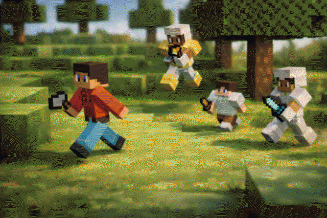

# Manhunt

## About this codebase
Note: This project originally used a build process that automated a lot of the things in this section, but it was removed for simplicity, which is why some things need to be done manually.
### Callbacks
To use a callback (let's say `tick`) in this project, write `CBs.tick = () => { ... [your code] };`, rather than defining the callback onto globalThis.   
Do make sure to not use one callback multiple times/in multiple files - instead, only assign the callback once, and call multiple methods inside of it (like [this](./src/manhunt.js#L408))   
When adding a new callback, it is **required** to add it to [usedCallbacks](./out/worldcode.js#L1) in worldcode.js.
### Exports/Imports
Every source file "exports" some variables, aka defines them onto `globalThis` for other files to use.   
Each file also has comments at the start, like `// Using shopManager From shop.js`, which specify what variables (or "exports") from other files are being used in its code. This is only for better understanding, but it's still good practice to update these comments when adding new "imports".   
What is **required** to do, however, is to add a definition for the exported variable to [init.js](./src/init.js), in case it gets referenced before actually being initialised.
### Understanding the code
If you want to use this project to get better at bloxd coding, probably just look at the main [Manhunt](./src/manhunt.js#L17) code first, and try to understand how the codebase is generally structured, and then try to understand more specific parts of it.   
(Or just do whatever you like best idk)

## World Code
On a high level, [worldcode.js](./out/worldcode.js) loads and executes the contents of codeblocks at specified positions, and also provides a basic (kind of) interrupt safe callback system.   
   
The callback system is really no magic, it simply stores a list of `interruptedCbs`, tries to execute those every tick, and removes callbacks from the list once they've been executed successfully.   
   
The actual code execution happens in stages:
- `0` is the starting stage, where code block data is being read and stored.
- In stage `1`, this code will actually get evaluated.
- Stage `2` means success.
- Stage `-1` basically means "done", whether successful or not. 

## Running the Game
To run this game yourself, place codeblocks at the positions specified in the `codeblockPositions` of [worldcode.js](./out/worldcode.js#L3-14), and fill them with the content of their respective files (e.g. `utils.js` goes in the codeblock at `0 -500 1`, etc).   
   
The [Lobby Schematic](./assets/Lobby.bloxdschem) should be pasted at the coordinates `-76 -256 -96`.   
   
Then, you can paste worldcode.js into the world code, and the game should be running!!