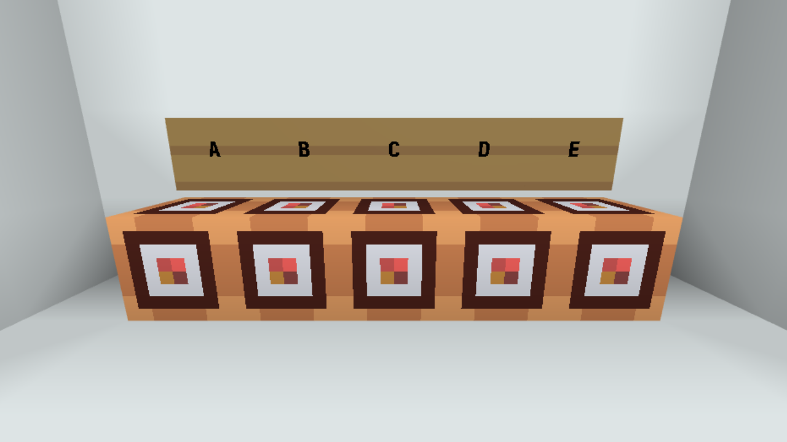

---

<div align="center">

<h1>Isolated Execution of Chained Code Blocks</h1>

<p>
This utility provides an optimized filter that decides — per player, per tick, per block — <br/>
whether the current code block should execute in the chain.
</p>

<p>
  <a href="#method-details"><kbd>Method Info</kbd></a>
  &nbsp;•&nbsp; <a href="#installation"><kbd>Installation</kbd></a>
  &nbsp;•&nbsp; <a href="#api"><kbd>API</kbd></a>
  &nbsp;•&nbsp; <a href="#example-layout"><kbd>Examples</kbd></a>
  &nbsp;•&nbsp; <a href="#performance-notes"><kbd>Performance</kbd></a>
</p>

</div>

<hr/>

<a id="method-details"></a>

## ℹ️ Method Details

<h3>〔 Basic usage 〕</h3>

Any code block (in the chain) that you want to control via “isolated execution” must call <code>isExeState</code> exactly once in that block.

> Typical pattern: wrap your main logic in some JavaScript conditional block, e.g. <code>if (isExeState(...)) { /\* main code \*/ }</code>.

<h3>〔 Indexing (offsets) 〕</h3>

Only code blocks (in the chain) that call <code>isExeState</code> take part in the per-tick index sequence.<br/>
The first executed (clicked) code block among those has index <code>0</code>, the next is <code>1</code>, then <code>2</code>, and so on.

> To know the indexes in your chain build, you can log to the chat from each participating code block to observe their execution order.

<h3>〔 Per-tick snapshot 〕</h3>

For each player and each new tick, only the first call of <code>isExeState</code> sets:

* the <i>chain length</i> (from <code>chainLength</code>), and
* the <i>entry code block position</i> (the one that was clicked/executed first; from <code>blockPosition</code>) with integers (x, y, z), and
* the <i>allowed indexes</i> for the rest of that tick (from <code>offsets</code>).

All subsequent <code>isExeState</code> calls for that player within the same tick reuse this snapshot.

<h3>〔 Multiple clicks within one tick 〕</h3>

Lags or autoclickers can produce multiple clicks in the same tick.

* The first <code>isExeState</code> call defines the snapshot for that tick.
* If the <i>entry code block</i> is executed again and the current index counter is still less than <code>chainLength</code>, the internal counter is reset at that block, so evaluation restarts from index <code>0</code> — using the same fixed offsets.
* If a <i>different code block</i> is clicked (executed) later in that tick, the snapshot does not change; evaluation continues with the existing fixed offsets and the ongoing index counter.

> * Indexes beyond the execution chain length are harmlessly ignored (unless you include them explicitly in <code>offsets</code>).
> * The <code>chainLength</code> is a safety measure and does not expand the 128-bit mask limit. It ensures that the internal index counter is reset correctly.

<h3>〔 Scope 〕</h3>

Players don’t affect each other’s execution chain states (snapshots, indexes, etc).

<h3>〔 Limits 〕</h3>

* Offsets are represented by a 128-bit mask, so supported indexes are <code>0..127</code>. Out-of-range indexes are ignored.
* The <code>chainLength</code> is independent of the mask size. Values <code>1..128</code> are recommended. Values <code>< 1</code> will allow to execute the chain only once within one tick.

---

<a id="installation"></a>

## 🔧 Installation

Paste the utility into your world code.<br/>

* [`Original (non-minified) version`](https://github.com/delfineonx/chained-code-blocks-isolated-execution/blob/main/src/isolated_execution_original.js)
* [`Manually minified version`](https://github.com/delfineonx/chained-code-blocks-isolated-execution/blob/main/src/isolated_execution_minified.js)

<h6>Optionally, keep only the <code>tick</code> callback in the world code and initialize the checker and/or bitmask helper from a separate place.</h6>

---

<a id="api"></a>

## 📚 API

```js
/**
 * Decide whether the current code block (by chain index, relative to the first code block
 * that called this function in the current tick) should execute for this player.
 *
 * Semantics of `offsets`:
 *  - null            -- allow ALL indexes (0..127)
 *  - undefined or [] -- allow NONE
 *  - number[]        -- allow exactly the listed 0-based execution indexes
 *
 * @param {PlayerId} playerId - The player who is executing the chain.
 * @param {[number, number, number]} blockPosition - The position of the code block (`thisPos`) which is currently being executed.
 * @param {number} [chainLength = 128] - Number of the code blocks in the chain which are calling this function (<= 128).
 * @param {number[] | null | undefined | Int32Array} [offsets = undefined] - Index list or bitmask words.
 * @param {boolean} [isBitmask = false] - Whether `offsets` is treated as an array of four int32 bitmask words (missing words are 0).
 * @returns {boolean} - Whether the current code block should execute in this tick.
 */
isExeState(playerId, blockPosition, chainLength, offsets, isBitmask)

/**
 * The helper to build a 128-bit mask (four int32 words) from a list of indexes.
 *
 * Semantics of `offsets`:
 *  - null            -- allow ALL indexes 0..127 (set all ones)
 *  - undefined or [] -- allow NONE (set all zeros)
 *  - number[]        -- allow exactly the listed 0-based execution indexes (set ones for specified)
 *
 * @param {number[] | null | undefined} [offsets] - Index list.
 * @param {boolean} [showMask = false] - Whether to log to the chat the result as an array of four uint32 bitmask words.
 * @param {number}  [displayBase = 10] - Numeric base for logging (2..36); 2/8/16 get 0b/0o/0x prefixes.
 * @returns {Int32Array} - Four-word bitmask.
 */
getBitmaskOffsets(offsets, showMask, displayBase)
```

<a id="example-layout"></a>

## 🧪 Example layout

<div align="center">
  <h3>〔 ――⠀5-block chain setup⠀―― 〕</h3>
  
  <h6>To replicate this setup you need to have the same A -> E indexing (correct relative build position): <code>api.setCameraDirection(playerId, [1, 0, 0])</code>.</h6><br/>
</div>

```js
// code block A
if (isExeState(playerId, thisPos, 5)) {
  api.log("A");
}
```
```js
// code block B
if (isExeState(playerId, thisPos, 5, [0])) {
  api.log("B");
}
```
```js
// code block C
if (isExeState(playerId, thisPos, 5, [2, 4])) {
  api.log("C");
}
```
```js
// code block D
if (isExeState(playerId, thisPos, 5, [0b01011], true)) {
  api.log("D");
}
```
```js
// code block E
if (isExeState(playerId, thisPos, 5, null)) {
  api.log("E");
}
```

<h3>〔 ――⠀Click results⠀―― 〕</h3>

<h4>code block A</h4>
&nbsp;&nbsp;<code>no logs</code>

<h4>code block B</h4>
&nbsp;&nbsp;<code>Log: "B"</code>

<h4>code block C</h4>
&nbsp;&nbsp;<code>Log: "E"</code><br/>
&nbsp;&nbsp;<code>Log: "A"</code>

<h4>code block D</h4>
&nbsp;&nbsp;<code>Log: "D"</code><br/>
&nbsp;&nbsp;<code>Log: "E"</code><br/>
&nbsp;&nbsp;<code>Log: "B"</code>

<h4>code block E</h4>
&nbsp;&nbsp;<code>Log: "E"</code><br/>
&nbsp;&nbsp;<code>Log: "D"</code><br/>
&nbsp;&nbsp;<code>Log: "C"</code><br/>
&nbsp;&nbsp;<code>Log: "D"</code><br/>
&nbsp;&nbsp;<code>Log: "A"</code>

---

<a id="performance-notes"></a>

## ⚙️ Performance notes

* **Time**
  * Per-block check:⠀<code>O(1)</code>.
  * Building a mask from an index list of length <code>N</code>:⠀<code>O(N)</code>⠀(only on the first call that establishes the per-tick snapshot).
  * Passing a prebuilt bitmask (<code>isBitmask = true</code>):⠀<code>O(1)</code>.
* **Memory (per player)**
  * <code>O(1)</code>⠀—⠀single <code>Int32Array(10)</code> (\~40 B).
* **Interruption points**
  * On the first call that establishes the per-tick snapshot:
    * <code>number\[]</code> — <code>14 + 2*N</code>
    * <code>null</code> — <code>8</code>
    * <code>undefined</code> — <code>11</code>
    * <code>\[]</code> — <code>10</code>
    * with <code>isBitmask = true</code> — <code>13</code>
  * For subsequent calls in participating code blocks within the same tick:
    * <code>chainLength >= 1</code> — <code>10</code>
    * <code>chainLength < 1</code> — <code>7</code>

---
